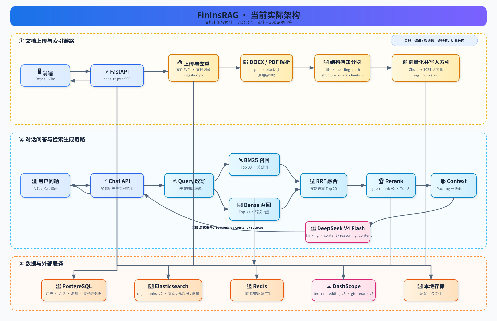

# FinInsRAG

面向金融、保险和企业制度文档的可解释知识问答平台。

FinInsRAG 将 PDF、DOCX、TXT、Markdown 和 Excel 文档解析为带标题、章节路径、页码和块类型的结构化 Chunk，再通过关键词检索、向量检索、RRF 融合、Rerank 和证据约束生成回答。

## 项目效果

仓库内 40 条金融制度问答评测集的回归基线：

| 指标 | 结果 | 说明 |
| --- | ---: | --- |
| Recall@20 | **100%** | 相关文档进入 Top-20 召回结果 |
| MRR@10 | **0.9625** | 相关文档在前 10 名中的排序质量 |
| 答案要点命中率 | **97.5%（39/40）** | 标注答案要点包含情况 |
| 引用 ID 合法率 | **100%** | 答案引用均来自本轮证据 |

以上是项目内部固定评测集的回归基线，不代表所有业务文档的线上指标。

## 核心能力

### 文档解析与结构化索引

- 基于 DeepDoc 解析 PDF、DOCX、TXT、Markdown 和 Excel；
- 保留 `title`、`heading_path`、`page`、`block_type`、`positions` 等结构元数据；
- 表格、列表和完整句子尽量不被字符上限硬切断；
- 使用 SHA-256 进行文档级去重，避免重复上传造成重复索引。

### 双路召回与排序

```text
BM25 独立召回 ─┐
                ├→ RRF 融合 → 近重复去除 → gte-rerank-v2 → Context Packing
Dense 独立召回 ─┘
```

- BM25 与 Dense 是两次独立的 Elasticsearch 请求；
- DashScope `text-embedding-v3` 生成 1024 维向量；
- DashScope `gte-rerank-v2` 对融合候选进行重排；
- Rerank 服务异常时自动回退到 RRF 结果。

### 多轮会话与证据约束生成

- 历史对话仅用于理解追问和指代，不能替代本轮检索证据；
- 默认限制最近 4 轮、约 2,000 tokens 的上下文；
- DeepSeek Thinking API 支持 `reasoning_content` 与 `content` 分离；
- 当模型只返回 `reasoning_content` 时执行答案回退与整理；
- 通过 SSE 流式返回思考片段、文档证据和最终答案；
- 校验 `[C1]` 引用编号，确保引用来自本轮证据。

### 工程化能力

- FastAPI、JWT 鉴权、PostgreSQL、Elasticsearch、Redis；
- 用户级文档隔离与会话级临时文档隔离；
- 临时文档自动过期清理；
- Docker Compose 一键启动后端及依赖服务；
- 提供文档上传、解析、索引、问答和评测脚本。

## 系统架构



```text
文档上传 → DeepDoc 解析 → 结构感知 Chunk → Embedding → rag_chunks_v2
问题 → 多轮追问改写 → BM25 + Dense → RRF → Rerank
                                             ↓
                                  Context Packing + [C1] 引用
                                             ↓
                                  DeepSeek SSE 流式回答
```

## 技术栈

```text
后端：Python、FastAPI、SQLAlchemy、Alembic
检索：Elasticsearch、BM25、Dense Vector、RRF、gte-rerank-v2
模型：DeepSeek Thinking、DashScope text-embedding-v3
存储：PostgreSQL、Redis、本地文件存储
前端：React、TypeScript、Vite、Ant Design
部署：Docker Compose、SSE
```

## 快速启动

### 后端

```cmd
cd backend
copy .env.example .env
docker compose config --quiet
docker compose up -d --build
docker compose ps
```

健康检查：<http://localhost:8001/health>

API 文档：<http://localhost:8001/docs>

### 前端

```cmd
cd ../frontend
npm install
npm run dev
```

访问：<http://localhost:5181/>

## 评测与测试

```cmd
cd backend
docker compose exec swxy_api python -m unittest discover -s tests -v
docker compose exec swxy_api python -m compileall -q .
docker compose exec swxy_api python evaluation/run_eval.py --ingest-fixtures --user-id rag-eval-user
docker compose exec swxy_api python evaluation/run_eval.py --user-id rag-eval-user --with-generation
```

## 项目目录

```text
backend/                  FastAPI、文档解析、检索与生成
frontend/                 React + Vite 用户界面
docs/                     项目学习与开发文档
architecture-current.svg  当前系统架构图
```

## 当前限制

- 扫描质量较差的 PDF、复杂跨页表格和合并单元格依赖 OCR/DeepDoc 识别质量；
- 40 条评测集用于回归验证，不能替代真实业务文档上的人工标注评估；
- Rerank 服务不可用时会回退到 RRF 排序；
- 首次构建需要下载 Python、系统依赖和模型资源，建议使用 Docker 启动。
