# FinInsRAG FastAPI 路由、依赖注入与中间件教程

本文基于当前项目真实代码编写，目标不是背 API，而是让你能在面试中讲清楚：

- 请求如何从前端进入 FastAPI。
- 路由如何分组。
- JWT 鉴权和数据库会话如何通过依赖注入进入接口。
- 中间件在请求生命周期中处于什么位置。
- 如何单独测试路由、依赖和中间件。

对应核心文件：

- `backend/app/app_main.py`
- `backend/app/router/user_rt.py`
- `backend/app/router/chat_rt.py`
- `backend/app/router/history_rt.py`
- `backend/app/service/auth.py`
- `backend/app/utils/database.py`

---

## 1. 项目 FastAPI 总入口

### 1.1 代码位置

入口文件是：

```text
backend/app/app_main.py
```

核心结构可以简化成：

```python
from fastapi import FastAPI
from fastapi.middleware.cors import CORSMiddleware
from router import chat_rt, user_rt, history_rt

app = FastAPI(root_path=root_path)

app.add_middleware(
    CORSMiddleware,
    allow_origins=["*"],
    allow_credentials=True,
    allow_methods=["*"],
    allow_headers=["*"],
)

app.include_router(chat_rt.router)
app.include_router(user_rt.router)
app.include_router(history_rt.router)

@app.on_event("startup")
def validate_configuration():
    validate_runtime_config()

@app.get("/health", include_in_schema=False)
def health():
    ...
```

### 1.2 请求进入后端的整体流程

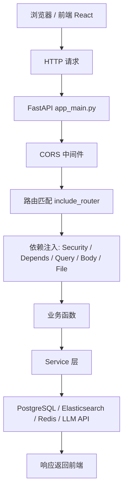

FastAPI 的工作不是直接把所有逻辑堆在 `app_main.py` 里，而是：

```text
app_main.py 负责组装应用
router/*.py 负责定义接口
service/*.py 负责业务逻辑
utils/database.py 负责数据库连接
schemas/*.py 负责请求和响应数据结构
```

### 1.3 为什么要 include_router

`include_router` 的作用是把不同模块里的接口注册到同一个 FastAPI 应用上。

当前项目注册了三个 router：

```python
app.include_router(chat_rt.router)
app.include_router(user_rt.router)
app.include_router(history_rt.router)
```

这意味着：

- `user_rt.py` 中的 `/login`、`/register` 会挂到主应用。
- `chat_rt.py` 中的 `/chat_on_docs`、`/upload_files` 会挂到主应用。
- `history_rt.py` 中的 `/get_sessions`、`/get_messages` 会挂到主应用。

当前项目没有设置统一 prefix，所以接口路径就是源码里写的路径。例如：

```text
POST /login
POST /chat_on_docs
GET /get_sessions
```

如果以后做工程化优化，可以考虑：

```python
app.include_router(user_rt.router, prefix="/api/user", tags=["user"])
app.include_router(chat_rt.router, prefix="/api/chat", tags=["chat"])
app.include_router(history_rt.router, prefix="/api/history", tags=["history"])
```

这样接口结构更清晰，但当前项目没有这么做。

---

## 2. 当前项目有哪些路由

### 2.1 总览表

| 模块 | 方法 | 路径 | 是否需要登录 | 主要作用 |
|---|---:|---|---|---|
| `app_main.py` | GET | `/health` | 否 | 检查 PostgreSQL、ES、Redis 是否可用 |
| `user_rt.py` | POST | `/register` | 否 | 注册用户 |
| `user_rt.py` | POST | `/login` | 否 | 登录并返回 JWT |
| `user_rt.py` | POST | `/sts-token` | 否 | 请求火山语音 STS Token |
| `chat_rt.py` | POST | `/create_session` | 是 | 创建会话 ID |
| `chat_rt.py` | POST | `/quick_parse` | 是 | 上传临时会话文档并解析索引 |
| `chat_rt.py` | GET | `/get_parsed_content` | 是 | 获取会话临时文档解析结果 |
| `chat_rt.py` | POST | `/chat_on_docs` | 是 | RAG 问答主接口，SSE 流式输出 |
| `chat_rt.py` | POST | `/upload_files` | 是 | 上传用户级持久文档并索引 |
| `chat_rt.py` | GET | `/sessions/{session_id}/documents` | 是 | 查询某会话上传文档列表 |
| `chat_rt.py` | GET | `/sessions/{session_id}/documents/summary` | 是 | 查询某会话文档摘要 |
| `history_rt.py` | GET | `/get_files` | 是 | 查询当前用户的文档列表 |
| `history_rt.py` | DELETE | `/delete_file/{file_name}` | 是 | 删除当前用户的指定文档 |
| `history_rt.py` | GET | `/get_messages` | 是 | 查询某会话消息历史 |
| `history_rt.py` | GET | `/get_sessions` | 是 | 查询当前用户的会话列表 |

---

## 3. 用户路由 user_rt.py

### 3.1 `/register` 注册接口

接口定义：

```python
@router.post("/register")
async def register(request: RegisterRequest):
    register_user(request.username, request.password)
    return {"message": "User registered successfully"}
```

请求体模型：

```python
class RegisterRequest(BaseModel):
    username: str
    password: str
```

这体现了 FastAPI 的一个核心特性：请求体自动解析。

当前端发送 JSON：

```json
{
  "username": "alice",
  "password": "123456"
}
```

FastAPI 会自动把它变成 `RegisterRequest` 对象：

```python
request.username
request.password
```

请求流程：

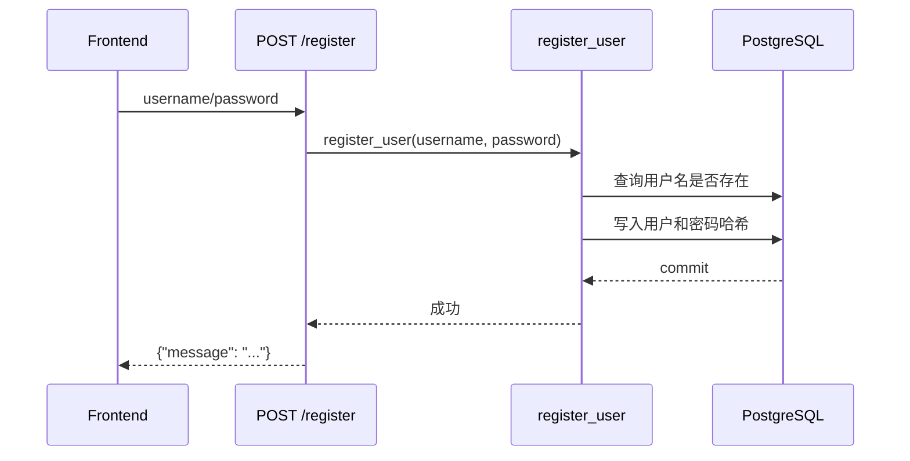

面试讲法：

```text
注册接口没有走 JWT 鉴权，因为用户此时还没有 token。
请求体使用 Pydantic 模型做结构校验，业务逻辑下沉到 service.auth.register_user。
```

### 3.2 `/login` 登录接口

接口定义：

```python
@router.post("/login")
async def login(request: LoginRequest):
    token = authenticate(request.username, request.password)
    return {"access_token": token, "token_type": "bearer"}
```

请求流程：

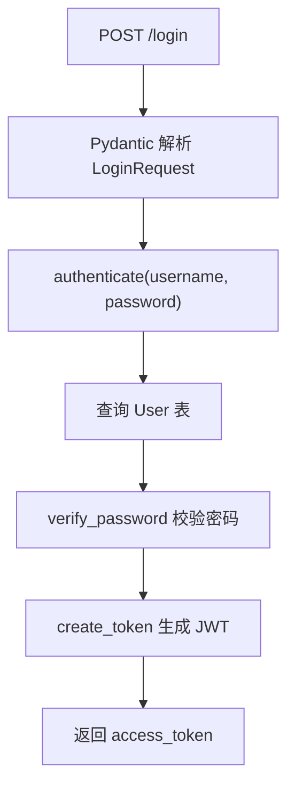

这里的重点是：登录接口本身不需要 `Security(access_security)`，它负责签发 token；后续需要登录的接口才校验 token。

### 3.3 `/sts-token` 语音临时 Token 接口

这个接口调用外部火山语音 API：

```python
async with httpx.AsyncClient() as client:
    response = await client.post(...)
```

它体现了异步 I/O 的使用场景：

```text
访问第三方 HTTP 服务时，用 async client 可以避免阻塞事件循环。
```

但这个接口和 RAG 主流程关系不大，可以作为附属能力理解。

---

## 4. 对话与文档路由 chat_rt.py

`chat_rt.py` 是当前项目最重要的路由模块，包含：

- 创建会话
- 上传文档
- 文档解析
- RAG 检索
- SSE 流式回答

### 4.1 `/create_session`

接口定义：

```python
@router.post("/create_session", response_model=SessionResponse)
async def create_session(
    credentials: JwtAuthorizationCredentials = Security(access_security),
):
    user_id = credentials.subject.get("user_id")
    session_id = str(uuid.uuid4()).replace("-", "")[:16]
    return {...}
```

这里出现了第一个重要依赖：

```python
credentials: JwtAuthorizationCredentials = Security(access_security)
```

它的意思是：

```text
这个接口执行前，FastAPI 先调用 access_security 校验 JWT。
校验通过后，把 token payload 注入到 credentials。
接口函数可以从 credentials.subject 中拿 user_id。
```

示意图：

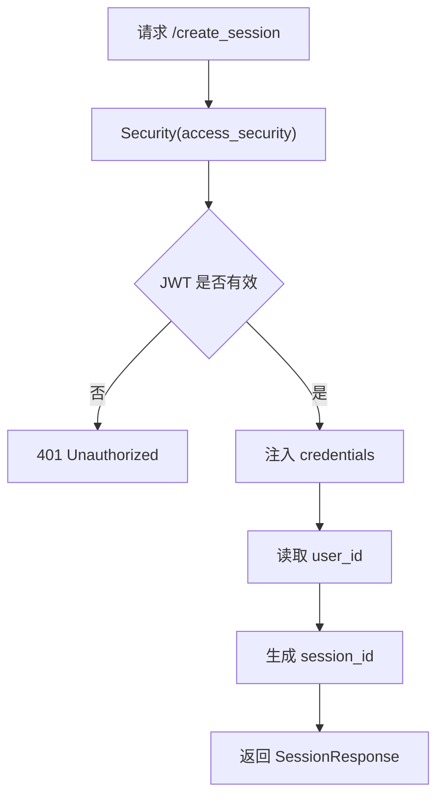

### 4.2 `/upload_files`

这个接口上传用户级文档，文档长期属于当前用户。

关键参数：

```python
async def upload_files(
    session_id: Optional[str] = Query(None),
    files: List[UploadFile] = File(...),
    credentials: JwtAuthorizationCredentials = Security(access_security),
    db: Session = Depends(get_db)
):
```

这里同时用了多种 FastAPI 参数来源：

| 参数 | 来源 | 作用 |
|---|---|---|
| `session_id` | `Query` | URL 查询参数 |
| `files` | `File` | multipart 文件上传 |
| `credentials` | `Security` | JWT 鉴权结果 |
| `db` | `Depends` | 数据库 Session |

上传流程：

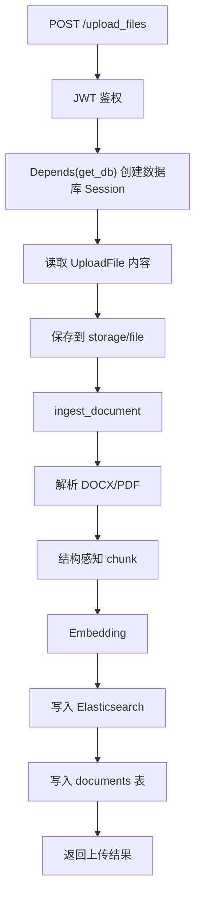

这个接口是理解项目索引链路的入口。

面试讲法：

```text
上传接口通过 JWT 获取 user_id，用 Depends(get_db) 获取当前请求生命周期内的数据库 Session。
文件先落盘，再进入 ingest_document。ingest_document 负责解析、切分、向量化、写 ES 和更新 PostgreSQL 元数据。
```

### 4.3 `/quick_parse`

`quick_parse` 和 `upload_files` 很像，但区别是作用域不同。

```python
ingest_document(
    file_path=file_path,
    file_name=safe_name,
    user_id=user_id,
    session_id=session_id,
    scope="session",
    ...
)
```

关键点：

```text
scope="session" 表示这是临时会话文档。
它会带 session_id，并设置过期时间，默认 24 小时。
```

与 `/upload_files` 对比：

| 接口 | scope | 是否绑定 session | 适用场景 |
|---|---|---|---|
| `/upload_files` | `user` | 否 | 用户长期知识库 |
| `/quick_parse` | `session` | 是 | 当前对话临时上传 |

示意图：

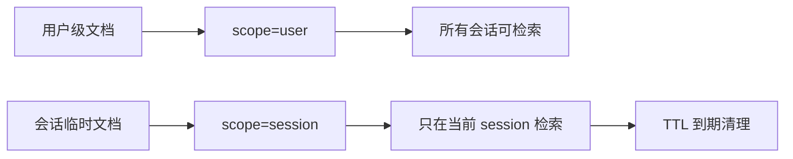

### 4.4 `/chat_on_docs`

这是 RAG 问答主接口。

接口定义：

```python
@router.post("/chat_on_docs")
async def chat_on_docs(
    session_id: str = Query(...),
    request: ChatRequest = Body(...),
    credentials: JwtAuthorizationCredentials = Security(access_security),
):
```

请求体：

```python
class ChatRequest(BaseModel):
    message: str
```

核心流程：

```python
history = load_conversation_history(session_id, user_id)
retrieval_query = rewrite_followup_question(question, history)
references = retrieve_content(user_id, retrieval_query, session_id)
return StreamingResponse(
    get_chat_completion(...),
    media_type="text/event-stream",
)
```

完整链路图：

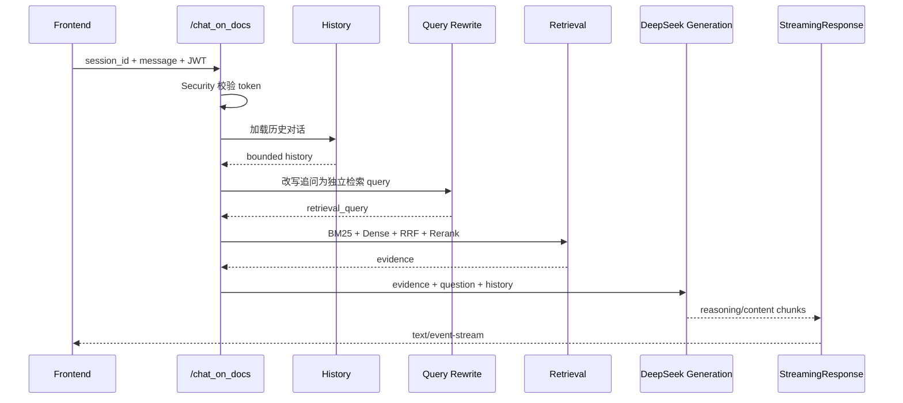

为什么这个接口返回 `StreamingResponse`？

```text
因为模型回答可能比较慢，SSE 可以边生成边返回，前端可以逐字显示。
```

SSE 的核心响应类型：

```python
StreamingResponse(..., media_type="text/event-stream")
```

面试讲法：

```text
RAG 问答接口不是普通 JSON 返回，而是 SSE 流式返回。路由层负责鉴权、读取历史、执行检索并启动流；真正的生成逻辑在 service.core.chat.get_chat_completion 中。
```

### 4.5 `/get_parsed_content`

这个接口用于查询当前 session 临时文档的解析内容：

```python
result = get_session_document_content(user_id, session_id)
```

它不是重新解析文档，而是从 ES 中按：

```text
user_id + scope=session + session_id + expires_at > now
```

查询已经索引好的 chunk，再拼接返回。

### 4.6 `/sessions/{session_id}/documents`

查询某个会话上传过哪些文件。

```python
documents = DocumentUploadService.get_session_documents(db, session_id)
```

注意：这里查的是 `document_uploads` 记录表，不等价于 ES 中实际可检索的 chunk。

### 4.7 `/sessions/{session_id}/documents/summary`

这个接口是上一接口的摘要版，返回：

- 是否有文档
- 最新文档名
- 最新文档类型
- 最新上传时间
- 文档总数

适合前端用来判断当前会话是否显示“已上传文档”状态。

---

## 5. 历史与文件路由 history_rt.py

### 5.1 `/get_files`

查询当前用户所有已就绪的用户级文档：

```python
stmt = select(Document).where(
    Document.user_id == user_id,
    Document.scope == "user",
    Document.parse_status == "ready",
)
```

这里体现了权限隔离：

```text
用户只能看到 user_id 等于自己的文档。
只返回 scope=user 的长期文档。
只返回 parse_status=ready 的文档。
```

示意图：

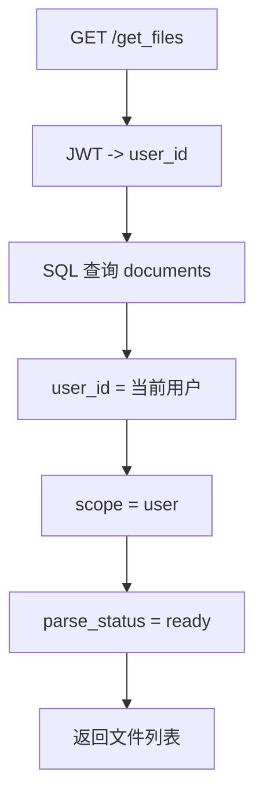

### 5.2 `/delete_file/{file_name}`

删除当前用户指定文件：

```python
result = delete_document(user_id, decoded_file_name, db)
```

这里有两个工程点：

```text
1. file_name 来自 URL path，需要 unquote 解码。
2. 删除必须带 user_id，避免用户删除别人的文档。
```

### 5.3 `/get_messages`

查询某个 session 的历史消息。

当前代码使用 SQL join：

```sql
SELECT ...
FROM messages AS m
JOIN sessions AS s ON s.session_id = m.session_id
WHERE m.session_id = :session_id AND s.user_id = :user_id
ORDER BY m.created_at ASC, m.message_id ASC
```

为什么要 join sessions？

```text
因为 messages 表里只有 session_id，不足以证明这个 session 属于当前用户。
join sessions 后，可以用 s.user_id = 当前用户 做权限隔离。
```

这是一个面试可以讲的安全点。

### 5.4 `/get_sessions`

查询当前用户的所有会话：

```sql
SELECT * FROM sessions WHERE user_id = :user_id
```

这是最简单的“按当前用户过滤”的接口。

---

## 6. 依赖注入 Depends 与 Security

FastAPI 的依赖注入是后端工程基础能力之一。当前项目主要用了两类：

- `Depends(get_db)`：注入数据库 Session。
- `Security(access_security)`：注入 JWT 鉴权结果。

### 6.1 `Depends(get_db)` 是什么

代码位置：

```text
backend/app/utils/database.py
```

核心代码：

```python
def get_db():
    db = SessionLocal()
    try:
        yield db
    finally:
        db.close()
```

路由中这样使用：

```python
db: Session = Depends(get_db)
```

它的生命周期：

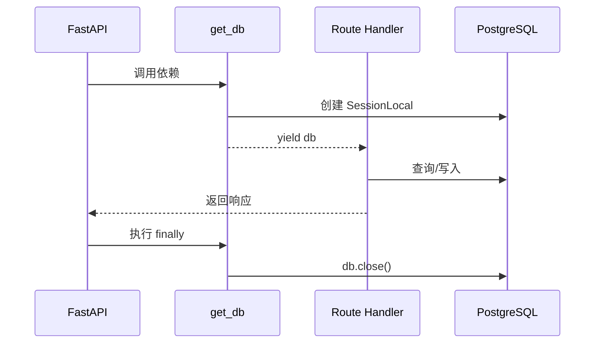

重点：

```text
yield 前是请求开始前的准备。
yield 出去的是路由函数可用的对象。
finally 是请求结束后的清理。
```

### 6.2 为什么不用全局 db

错误写法：

```python
db = SessionLocal()

@router.get("/xxx")
def api():
    db.query(...)
```

问题：

```text
多个请求会共享同一个 Session，容易出现连接泄漏、事务污染、并发问题。
```

正确写法：

```python
def get_db():
    db = SessionLocal()
    try:
        yield db
    finally:
        db.close()
```

每个请求单独创建、单独关闭。

### 6.3 `Security(access_security)` 是什么

代码位置：

```text
backend/app/service/auth.py
```

核心对象：

```python
access_security = JwtAccessBearerCookie(
    secret_key=JWT_SECRET_KEY,
    auto_error=True,
    access_expires_delta=timedelta(days=2)
)
```

路由中这样使用：

```python
credentials: JwtAuthorizationCredentials = Security(access_security)
```

作用：

```text
从请求 Header 或 Cookie 里读取 JWT。
校验签名和有效期。
校验通过后，把 token payload 注入 credentials。
```

使用方式：

```python
user_id = credentials.subject.get("user_id")
```

JWT 鉴权流程：

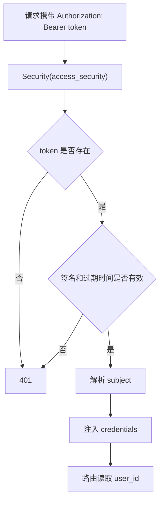

### 6.4 Depends 和 Security 的区别

| 类型 | 用途 | 当前项目例子 |
|---|---|---|
| `Depends` | 通用依赖注入 | `db: Session = Depends(get_db)` |
| `Security` | 安全/认证相关依赖 | `credentials = Security(access_security)` |

你可以这样理解：

```text
Security 是更语义化的 Depends，专门用于认证授权。
```

---

## 7. 中间件 Middleware

当前项目显式配置了一个中间件：

```python
app.add_middleware(
    CORSMiddleware,
    allow_origins=["*"],
    allow_credentials=True,
    allow_methods=["*"],
    allow_headers=["*"],
)
```

### 7.1 中间件在请求生命周期中的位置

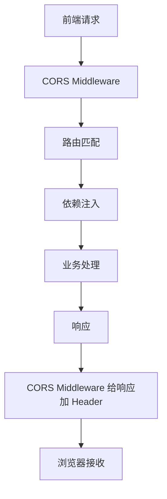

中间件在路由之前执行，也可以在响应返回前再次处理。

### 7.2 CORS 是什么

浏览器有同源策略。

如果前端是：

```text
http://localhost:5173
```

后端是：

```text
http://localhost:8001
```

两者端口不同，就是不同源。浏览器会检查后端响应中是否允许跨域。

`CORSMiddleware` 会加上类似响应头：

```http
Access-Control-Allow-Origin: *
Access-Control-Allow-Credentials: true
```

这样前端才能调用后端。

### 7.3 当前 CORS 配置的优缺点

当前配置：

```python
allow_origins=["*"]
allow_credentials=True
allow_methods=["*"]
allow_headers=["*"]
```

优点：

```text
本地开发方便，不容易被跨域问题卡住。
```

缺点：

```text
生产环境过宽，应该限制具体前端域名。
```

生产环境更推荐：

```python
allow_origins=[
    "https://your-frontend-domain.com",
]
```

---

## 8. 请求参数来源

当前项目用到了 FastAPI 的多种参数声明方式。

### 8.1 `Body`

用于 JSON 请求体。

```python
request: ChatRequest = Body(...)
```

前端发送：

```json
{
  "message": "三创赛能拿多少钱？"
}
```

后端读取：

```python
request.message
```

### 8.2 `Query`

用于 URL 查询参数。

```python
session_id: str = Query(...)
```

请求形式：

```text
POST /chat_on_docs?session_id=abc123
```

### 8.3 `File`

用于文件上传。

```python
files: List[UploadFile] = File(...)
```

请求类型是：

```text
multipart/form-data
```

### 8.4 Path 参数

路径参数直接写在 URL 中：

```python
@router.delete("/delete_file/{file_name}")
async def delete_document_endpoint(file_name: str, ...):
```

请求形式：

```text
DELETE /delete_file/xxx.pdf
```

### 8.5 参数来源示意图

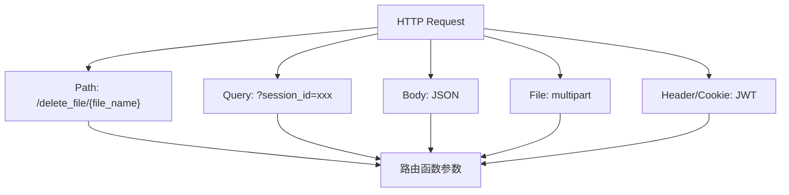

---

## 9. 单独测试代码教程

下面的测试分两类：

- 不依赖真实数据库/ES/LLM 的单元测试。
- 依赖 Docker 服务的接口测试。

建议先学第一类，容易理解 FastAPI 的机制。

### 9.1 安装测试依赖

如果在容器中测试，项目已有 FastAPI 依赖。额外常用的是：

```bash
pip install pytest
```

如果用 Docker：

```powershell
cd D:\Personal\Desktop\作品\暑期项目\FinlnsRAG_\backend
docker compose exec swxy_api pytest
```

### 9.2 测试 `/health`

新建文件：

```text
backend/app/tests/test_fastapi_health.py
```

代码：

```python
from fastapi.testclient import TestClient

from app_main import app


client = TestClient(app)


def test_health_endpoint_returns_status():
    response = client.get("/health")

    assert response.status_code in {200, 503}
    data = response.json()
    assert "status" in data
    assert "checks" in data
    assert set(data["checks"]) == {"postgres", "elasticsearch", "redis"}
```

这个测试重点不是要求依赖一定健康，而是验证接口结构稳定。

### 9.3 测试 Pydantic 请求体

测试 `/login` 时，不建议直接碰真实数据库。可以 monkeypatch 掉 `authenticate`。

```python
from fastapi.testclient import TestClient

from app_main import app
from router import user_rt


client = TestClient(app)


def test_login_success(monkeypatch):
    def fake_authenticate(username, password):
        assert username == "alice"
        assert password == "123456"
        return "fake-token"

    monkeypatch.setattr(user_rt, "authenticate", fake_authenticate)

    response = client.post(
        "/login",
        json={"username": "alice", "password": "123456"},
    )

    assert response.status_code == 200
    assert response.json() == {
        "access_token": "fake-token",
        "token_type": "bearer",
    }
```

这个测试证明：

```text
FastAPI 能把 JSON 请求体解析成 LoginRequest。
路由函数会调用 authenticate。
返回值结构符合预期。
```

### 9.4 测试 Depends(get_db)

FastAPI 支持覆盖依赖：

```python
app.dependency_overrides[get_db] = fake_get_db
```

示例：

```python
from fastapi.testclient import TestClient

from app_main import app
from utils.database import get_db


class FakeDB:
    def __init__(self):
        self.closed = False

    def close(self):
        self.closed = True


def fake_get_db():
    db = FakeDB()
    try:
        yield db
    finally:
        db.close()


def test_dependency_override_example():
    app.dependency_overrides[get_db] = fake_get_db
    try:
        assert get_db in app.dependency_overrides
    finally:
        app.dependency_overrides.clear()
```

真正测试某个依赖数据库的接口时，可以把数据库操作也 monkeypatch 掉。

### 9.5 测试需要 JWT 的接口

`/create_session` 需要：

```python
credentials: JwtAuthorizationCredentials = Security(access_security)
```

单测里可以覆盖 `access_security`。

示例：

```python
from fastapi.testclient import TestClient

from app_main import app
from service.auth import access_security


class FakeCredentials:
    subject = {"user_id": 1, "user_name": "alice"}


def fake_access_security():
    return FakeCredentials()


def test_create_session_with_fake_jwt():
    app.dependency_overrides[access_security] = fake_access_security
    try:
        client = TestClient(app)
        response = client.post("/create_session")

        assert response.status_code == 200
        data = response.json()
        assert data["status"] == "success"
        assert len(data["session_id"]) == 16
    finally:
        app.dependency_overrides.clear()
```

重点：

```text
测试路由逻辑时，不一定要真的生成 JWT。
可以用 dependency_overrides 替换鉴权依赖。
```

### 9.6 测试 SSE 接口思路

`/chat_on_docs` 依赖真实检索和模型，单测时应该 monkeypatch：

- `load_conversation_history`
- `rewrite_followup_question`
- `retrieve_content`
- `get_chat_completion`

示例：

```python
from fastapi.testclient import TestClient

from app_main import app
from router import chat_rt
from service.auth import access_security


class FakeCredentials:
    subject = {"user_id": 1}


def fake_access_security():
    return FakeCredentials()


def fake_stream(*args, **kwargs):
    yield 'event: message\ndata: {"role":"assistant","content":"hello"}\n\n'
    yield "event: end\ndata: [DONE]\n\n"


def test_chat_on_docs_sse(monkeypatch):
    app.dependency_overrides[access_security] = fake_access_security
    monkeypatch.setattr(chat_rt, "load_conversation_history", lambda *args: [])
    monkeypatch.setattr(chat_rt, "rewrite_followup_question", lambda q, h: q)
    monkeypatch.setattr(chat_rt, "retrieve_content", lambda *args: [])
    monkeypatch.setattr(chat_rt, "get_chat_completion", fake_stream)

    try:
        client = TestClient(app)
        response = client.post(
            "/chat_on_docs?session_id=test123",
            json={"message": "hello"},
        )

        assert response.status_code == 200
        assert "text/event-stream" in response.headers["content-type"]
        assert "[DONE]" in response.text
    finally:
        app.dependency_overrides.clear()
```

这个测试不是测试模型效果，而是测试：

```text
接口能进入。
依赖能注入。
SSE 响应格式能返回。
```

---

## 10. 手动接口测试教程

### 10.1 启动服务

Docker 后端：

```powershell
cd D:\Personal\Desktop\作品\暑期项目\FinlnsRAG_\backend
docker compose up -d
```

查看健康状态：

```powershell
Invoke-WebRequest -UseBasicParsing http://localhost:8001/health
```

### 10.2 注册用户

```powershell
curl.exe -X POST http://localhost:8001/register `
  -H "Content-Type: application/json" `
  -d "{\"username\":\"alice\",\"password\":\"123456\"}"
```

### 10.3 登录获取 token

```powershell
$login = curl.exe -s -X POST http://localhost:8001/login `
  -H "Content-Type: application/json" `
  -d "{\"username\":\"alice\",\"password\":\"123456\"}" | ConvertFrom-Json

$token = $login.access_token
```

### 10.4 创建会话

```powershell
curl.exe -X POST http://localhost:8001/create_session `
  -H "Authorization: Bearer $token"
```

### 10.5 调用问答接口

```powershell
curl.exe -N -X POST "http://localhost:8001/chat_on_docs?session_id=你的session_id" `
  -H "Authorization: Bearer $token" `
  -H "Content-Type: application/json" `
  -d "{\"message\":\"三创赛能拿多少钱？\"}"
```

`-N` 的作用是关闭 curl 缓冲，更容易看到 SSE 流式输出。

---

## 11. 实践作业与参考答案

### 作业 1：画出 `/chat_on_docs` 的请求链路

要求：

```text
从前端发请求开始，画到模型 SSE 返回为止。
必须包含：JWT、history、query rewrite、retrieval、generation、StreamingResponse。
```

参考答案：

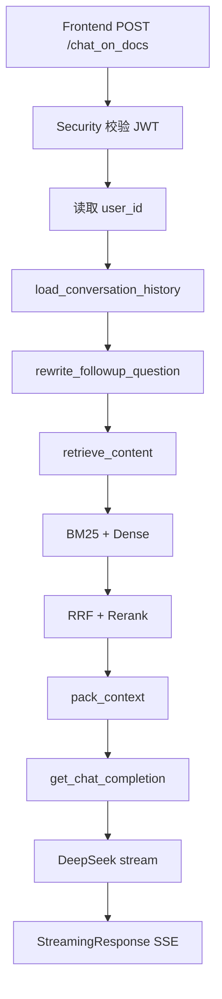

### 作业 2：解释 `Depends(get_db)` 的生命周期

参考答案：

```text
FastAPI 在进入路由函数前调用 get_db，创建 SQLAlchemy Session。
get_db 使用 yield 把 db 交给路由函数。
路由函数执行结束后，无论成功还是异常，finally 都会执行 db.close()。
这样可以保证每个请求都有独立数据库会话，并避免连接泄漏。
```

### 作业 3：为什么 `/login` 不需要 JWT，而 `/create_session` 需要 JWT

参考答案：

```text
/login 的职责是校验用户名密码并签发 JWT，此时用户还没有 token，因此不能要求 JWT。
/create_session 是登录后的业务接口，需要知道当前用户是谁，因此必须通过 Security(access_security) 校验 JWT 并从 credentials.subject 中获取 user_id。
```

### 作业 4：写一个测试，验证 `/create_session` 返回 16 位 session_id

参考答案：

```python
from fastapi.testclient import TestClient

from app_main import app
from service.auth import access_security


class FakeCredentials:
    subject = {"user_id": 1}


def fake_access_security():
    return FakeCredentials()


def test_create_session_returns_16_char_id():
    app.dependency_overrides[access_security] = fake_access_security
    try:
        client = TestClient(app)
        response = client.post("/create_session")
        assert response.status_code == 200
        assert len(response.json()["session_id"]) == 16
    finally:
        app.dependency_overrides.clear()
```

### 作业 5：说明 `/upload_files` 和 `/quick_parse` 的区别

参考答案：

```text
/upload_files 上传的是用户级持久文档，ingest_document 使用 scope="user"，后续该用户的其他会话也可以检索。
/quick_parse 上传的是会话级临时文档，ingest_document 使用 scope="session"，绑定 session_id，并设置过期时间，主要用于当前对话临时问答。
```

### 作业 6：为什么 `/get_messages` 要 join sessions 表

参考答案：

```text
messages 表按 session_id 存消息，但仅凭 session_id 不能证明该会话属于当前用户。
join sessions 表后，可以增加 s.user_id = 当前用户 的条件，避免用户通过猜测 session_id 读取别人的会话记录。
这是接口层权限隔离的重要细节。
```

### 作业 7：CORS 中间件解决了什么问题

参考答案：

```text
浏览器限制不同源之间的请求。当前前端运行在 localhost:5173，后端运行在 localhost:8001，端口不同，属于不同源。
CORSMiddleware 给响应添加跨域相关 Header，使浏览器允许前端调用后端接口。
```

### 作业 8：如果接口需要同时接收文件和 token，应该怎么写参数

参考答案：

```python
from fastapi import File, UploadFile, Security, Depends
from fastapi_jwt import JwtAuthorizationCredentials
from sqlalchemy.orm import Session

from service.auth import access_security
from utils.database import get_db


async def api(
    file: UploadFile = File(...),
    credentials: JwtAuthorizationCredentials = Security(access_security),
    db: Session = Depends(get_db),
):
    user_id = credentials.subject.get("user_id")
    ...
```

---

## 12. 面试表达模板

如果面试官问：“你这个项目 FastAPI 后端是怎么设计的？”

可以这样答：

```text
项目入口是 app_main.py，里面创建 FastAPI 实例，配置 CORS 中间件，注册 user、chat、history 三组 router，并提供 /health 做依赖健康检查。

路由层主要负责参数解析、JWT 鉴权、数据库 Session 注入和异常转换。比如 RAG 主接口 /chat_on_docs 使用 Security(access_security) 获取当前用户，用 Query 获取 session_id，用 Body 解析用户问题，然后调用 service 层完成历史加载、query rewrite、混合检索、rerank、context packing 和 SSE 生成。

数据库连接通过 Depends(get_db) 管理，每个请求创建一个 SQLAlchemy Session，请求结束后自动 close，避免连接泄漏。

认证使用 fastapi-jwt，登录接口签发 token，业务接口通过 Security(access_security) 校验 token 并从 credentials.subject 里取 user_id，保证文档、会话和消息都按用户隔离。

中间件目前主要是 CORS，用于支持本地前端 localhost:5173 调用后端 localhost:8001。生产环境可以把 allow_origins 从通配符收紧到具体域名。
```

---

## 13. 学习检查清单

学完这一部分，你应该能做到：

- 能说清楚 `app_main.py` 的作用。
- 能列出三个 router 模块分别负责什么。
- 能解释 `Depends(get_db)` 的生命周期。
- 能解释 `Security(access_security)` 如何拿到用户身份。
- 能区分 `Body`、`Query`、`File`、Path 参数。
- 能说明为什么 `/chat_on_docs` 用 `StreamingResponse`。
- 能写一个不依赖真实 JWT 的路由单元测试。
- 能解释 CORS 为什么在本项目前后端联调中必需。

